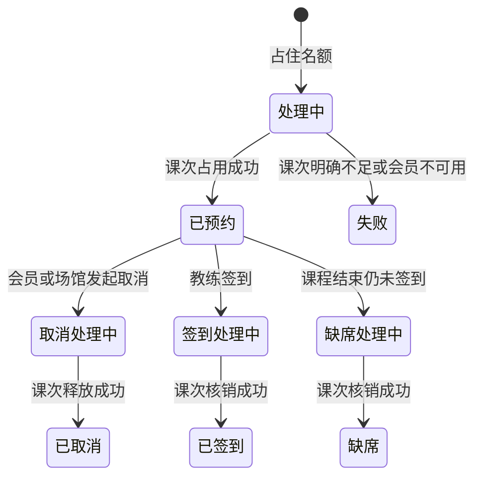

# FlowYoga 业务规则

本文是第一期的业务规则。规则编号用于后续设计和测试引用。带“当前取值”的参数可以在调研后调整，但调整时只改参数，不改服务边界。

时间一律按 Asia/Shanghai 解释。课次时间采用左闭右开区间 `[开始, 结束)`，因此两节课首尾相接不算冲突。

## 1. 范围规则

| 编号 | 规则 |
| --- | --- |
| R-01 | 系统只服务一家瑜伽馆，不提供门店切换。 |
| R-02 | 第一期只有团体课。一节课有一名教练、一间教室、一个名额上限。 |
| R-03 | 会员持有的是次卡。一次有效上课或一次缺席消耗一次，取消成功则退回一次。 |
| R-04 | 开卡不接在线支付。管理员选择套餐后开卡，系统保存套餐标价作为线下收款记录。 |
| R-05 | 一个登录账号只有一个角色：管理员、教练或会员。 |

## 2. 账号、教练与会员

| 编号 | 规则 |
| --- | --- |
| R-06 | 手机号和登录名在全部账号中唯一。密码只保存摘要，不保存明文。 |
| R-07 | 创建教练时先建立角色为教练的账号，再建立教练资料，两边用同一个用户编号关联。创建会员同理。 |
| R-08 | 停用的教练不能被排入新课，已排未上的课需要管理员另行调整。 |
| R-09 | 停用的会员不能新预约，已存在的预约仍按取消、签到和缺席规则处理。 |

## 3. 课程、教室与排课

| 编号 | 规则 |
| --- | --- |
| R-10 | 教室有容纳人数。课次名额必须大于等于 1，且不能超过教室容纳人数。 |
| R-11 | 课次必须指定启用状态的课程、教练和教室，结束时间晚于开始时间，时长不超过 4 小时。 |
| R-12 | 同一教练的两节未取消课次如果时间重叠，拒绝保存。 |
| R-13 | 同一教室的两节未取消课次如果时间重叠，拒绝保存。 |
| R-14 | 已取消的课次不参与冲突判断，也不接受新的预约。 |
| R-15 | 冲突错误必须同时说明冲突类型、对方课次、课程名称和时间段。示例：`教室冲突：A 教室在 2026-11-02 19:00–20:00 已安排“肩颈放松”。` |
| R-16 | 已有预约的课次，名额不能改到小于已占用人数；更改教练、教室或时间时重新做冲突检测。 |
| R-17 | 管理员只能在开课前取消整节课。该课上尚未核销的预约释放名额和课次，不扣次。已经核销的记录保持不变。正常情况下开课前还不存在签到记录。 |

## 4. 次卡与开卡

| 编号 | 规则 |
| --- | --- |
| R-18 | 套餐包含名称、次数、有效天数和标价。开卡时把这些值复制到会员卡上，之后修改套餐不影响已开出的卡。 |
| R-19 | 有效期从开卡当日开始，到到期日的 23:59:59 为止。过期后不能再用于新预约。 |
| R-20 | 会员可以同时持有多张卡。预约时如果会员不指定卡，系统选择未过期、状态正常且剩余次数大于 0 的卡里，到期时间最早的一张。 |
| R-21 | 会员指定卡时，只使用该卡。该卡不可用则预约失败，不自动换卡。 |
| R-22 | 剩余次数在预约占用成功时减 1，取消释放时加 1，签到核销和缺席确认不再减第二次。 |

## 5. 预约、取消、签到与缺席

| 编号 | 规则 | 当前取值 |
| --- | --- | --- |
| R-23 | 只有正常状态、未过期且剩余次数大于 0 的卡才能占用。 | — |
| R-24 | 只能预约状态为可预约、开始时间晚于当前时间、且仍有名额的课次。 | — |
| R-25 | 同一会员对同一课次最多一条有效预约。连续点击返回原来的预约，不占用第二次。 | — |
| R-26 | 多个请求同时抢最后一个名额时，成功占用的预约数不能超过剩余名额。 | — |
| R-27 | 会员取消必须不晚于开课前的截止时间，且预约尚未核销。 | 开课前 120 分钟 |
| R-28 | 超过取消截止时间后，会员不能取消。未签到到课结束记为缺席，并消耗这一次。 | 缺席扣 1 次 |
| R-29 | 教练只能给自己的课签到，且只能签到已预约成功的会员。 | — |
| R-30 | 签到只在签到窗口内允许。窗口外签到被拒绝。 | 开课前 15 分钟至下课时间 |
| R-31 | 接口只有在名额占用和课次占用都成功后，才能告诉会员预约成功。调用超时、会员卡服务不可用或结果未知时，返回处理中或失败，不能返回成功。 | — |

有效预约指尚未取消、尚未失败的预约。取消成功或占用失败后，会员可以再次预约同一课次。

## 6. 预约状态

名额占用包括：处理中、已预约、取消处理中、签到处理中、已签到、缺席处理中、缺席。失败和已取消不占名额。

## 7. 跨服务课次规则

课程服务负责名额，会员卡服务负责次数。两边都不直接读写对方的数据库。跨服务只使用预约编号关联，预约编号全局唯一。

会员卡服务对每个预约编号只保留一条课次流水，状态只能按下面的方向变化：

| 当前状态 | 收到的操作 | 结果 |
| --- | --- | --- |
| 无 | 占用 | 剩余次数减 1，流水变为已占用 |
| 已占用 | 占用 | 不重复扣次，返回现有流水 |
| 已占用 | 核销 | 剩余次数不变，流水变为已核销 |
| 已占用 | 释放 | 剩余次数加 1，流水变为已释放 |
| 已核销或已释放 | 任意操作 | 不改次数，返回现有流水 |

课程服务的本地顺序：

1. 在同一个本地事务里检查重复预约，用条件更新占住名额，并写入“处理中”预约。事务提交后才调用会员卡服务。
2. 会员卡服务返回占用成功后，预约改为已预约，这时才能向会员返回成功。
3. 会员卡服务明确返回不能占用时，课程服务释放名额，预约改为失败，向会员返回失败。
4. 调用超时、连接失败或响应丢失时，预约保持处理中。页面提示处理中。后台按同一个预约编号重试占用。
5. 取消、签到、缺席同样先进入对应的处理中状态，会员卡服务成功后再进入最终状态。重试仍然使用原预约编号。

定时核对至少覆盖这些不一致：

- 课程侧已预约，会员卡侧没有已占用流水：重试占用；多次失败则释放名额并标记失败。
- 课程侧已取消，会员卡侧仍是已占用：重试释放。
- 课程侧已失败，会员卡侧仍是已占用：重试释放。
- 课程侧已签到或已缺席，会员卡侧仍是已占用：重试核销。

核对任务本身也要能重复执行，不能因为任务跑两次而多扣一次。

## 8. 统计口径

统计范围默认排除已取消的课次。

| 指标 | 计算 | 核对关系 |
| --- | --- | --- |
| 预约率 | 占用名额的预约数 ÷ 课次名额之和 | 分子来自预约表，分母来自课次表 |
| 出勤率 | 已签到 ÷（已签到 + 缺席） | 只统计已经结束的课次 |
| 课次消耗 | 状态为已核销的流水数 | 等于已签到预约数加缺席预约数 |

处理中的预约计入预约率分子，因为名额已经被占住。未结束课次不进入出勤率。

## 9. 权限规则

| 编号 | 规则 |
| --- | --- |
| R-32 | 未登录访问业务接口返回未认证。角色不匹配返回无权限。 |
| R-33 | 会员不能访问管理员和教练接口。教练不能访问管理员接口。 |
| R-34 | 教练即使知道其他课次的编号，也不能查看名单或签到。服务按当前教练与课次的授课关系判断。 |
| R-35 | 会员只能查看和取消自己的预约、会员卡和上课记录。 |
| R-36 | 网关校验令牌后，业务服务仍要校验角色和数据归属。业务服务不因为请求来自网关就跳过授权。 |

## 10. 当前可调参数

| 参数 | 当前取值 | 影响的规则 |
| --- | --- | --- |
| 取消提前量 | 120 分钟 | R-27 |
| 缺席是否扣次 | 扣 1 次 | R-28 |
| 签到窗口 | 开课前 15 分钟至下课 | R-30 |
| 单次课程最长时长 | 240 分钟 | R-11 |

这些值在实现时放到配置中。调研如果要求改成开课前 4 小时取消，或临时取消改为不扣次，只调整对应参数和它的测试，不改变“课程服务管名额、会员卡服务管次数”的边界。
