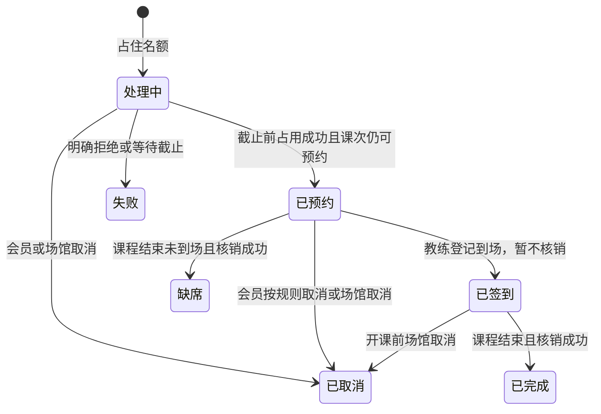

# FlowYoga 业务规则

本文是第一期的业务规则。规则编号用于后续设计和测试引用。带“当前取值”的参数可以在调研后调整，但调整时只改参数，不改服务边界。

时间一律按 Asia/Shanghai 解释。课次时间采用左闭右开区间 `[开始, 结束)`，因此两节课首尾相接不算冲突。

## 1. 范围规则

| 编号 | 规则 |
| --- | --- |
| R-01 | 系统只服务一家瑜伽馆，不提供门店切换。 |
| R-02 | 第一期只有团体课。一节课有一名教练、一间教室、一个名额上限。 |
| R-03 | 会员持有的是次卡。一次有效上课或一次缺席消耗一次，取消成功则退回一次。 |
| R-04 | 开卡不接在线支付。管理员分别确认套餐标价快照与实际线下收款金额，实际收款不得由标价自动替代；两者不同时填写原因。 |
| R-05 | 一个登录账号只有一个角色：管理员、教练或会员。 |

## 2. 账号、教练与会员

| 编号 | 规则 |
| --- | --- |
| R-06 | 手机号和登录名在全部账号中唯一。密码只保存摘要，不保存明文。 |
| R-07 | 创建教练时先建立角色为教练的账号，再建立教练资料，两边用同一个用户编号关联。创建会员同理。 |
| R-08 | 停用的教练不能被排入新课，已排未上的课需要管理员另行调整。 |
| R-09 | 停用的会员不能新预约，已存在的预约仍按取消、签到和缺席规则处理。 |

## 3. 课程、教室与排课

| 编号 | 规则 |
| --- | --- |
| R-10 | 教室有容纳人数。课次名额必须大于等于 1，且不能超过教室容纳人数。 |
| R-11 | 课次必须指定启用状态的课程、教练和教室，结束时间晚于开始时间，时长不超过 4 小时。 |
| R-12 | 同一教练的两节未取消课次如果时间重叠，拒绝保存。 |
| R-13 | 同一教室的两节未取消课次如果时间重叠，拒绝保存。 |
| R-14 | 已取消的课次不参与冲突判断，也不接受新的预约。 |
| R-15 | 冲突错误必须同时说明冲突类型、对方课次、课程名称和时间段。示例：`教室冲突：A 教室在 2026-11-02 19:00–20:00 已安排“肩颈放松”。` |
| R-16 | 已有预约的课次，名额不能改到小于已占用人数；更改教练、教室或时间时重新做冲突检测。 |
| R-17 | 管理员只能在开课前取消整节课。取消决定、该课全部有效预约的关闭、名额释放及每个预约的课次释放任务在课程服务同一个本地事务中提交。提前签到也只登记到场，仍按场馆取消释放课次，不扣次；到场时间作为历史记录保留。取消与签到、预约确认使用同一课次的锁或版本检查，取消后不能新增签到或确认预约。 |

## 4. 次卡与开卡

| 编号 | 规则 |
| --- | --- |
| R-18 | 套餐包含名称、次数、有效天数和标价。开卡时把这些值复制到会员卡上，之后修改套餐不影响已开出的卡。 |
| R-37 | 开卡记录另存实际收款金额、收款时间、操作管理员和金额差异原因。金额使用人民币元，最多两位小数且不得小于 0；实际收款是必填项，不能仅保存套餐标价。后续修改套餐不改变历史收款记录。 |
| R-19 | 有效期从开卡当日开始，到到期日的 23:59:59 为止。过期后不能再用于新预约。 |
| R-20 | 会员可以同时持有多张卡。预约时如果会员不指定卡，系统选择未过期、状态正常且剩余次数大于 0 的卡里，到期时间最早的一张。 |
| R-21 | 会员指定卡时，只使用该卡。该卡不可用则预约失败，不自动换卡。 |
| R-22 | 剩余次数在预约占用成功时减 1，取消或预约失败后的释放成功时加 1；签到只登记到场。课程结束后核销到场或缺席的占用，不再减第二次。 |

## 5. 预约、取消、签到与缺席

| 编号 | 规则 | 当前取值 |
| --- | --- | --- |
| R-23 | 只有正常状态、未过期且剩余次数大于 0 的卡才能占用。 | — |
| R-24 | 只能预约状态为可预约、开始时间晚于当前时间、且仍有名额的课次。 | — |
| R-25 | 同一会员对同一课次最多一条有效预约。连续点击返回原来的预约，不占用第二次。 | — |
| R-26 | 多个请求同时抢最后一个名额时，成功占用的预约数不能超过剩余名额。 | — |
| R-27 | 会员只能取消自己的处理中或已预约记录，且必须不晚于开课前的截止时间。课程服务关闭预约并释放名额后，课次返还可以处于待释放，页面明确显示返还进度。 | 开课前 120 分钟 |
| R-28 | 超过取消截止时间后，会员不能取消。课程结束时，仅对预约已确认、课次未取消的会员判断到场或缺席；从未确认成功的预约不记缺席、不核销。 | 缺席扣 1 次 |
| R-29 | 教练只能给自己的课签到，且只能签到已预约成功的会员。 | — |
| R-30 | 签到窗口为 `[开课前 15 分钟, 下课时间)`，只在本地登记一次到场时间并将预约改为已签到。课程结束且未取消后，后台才调用会员卡服务核销；窗口外签到被拒绝。 | 开课前 15 分钟至下课前 |
| R-31 | 接口只有在名额占用和课次占用都成功后，才能告诉会员预约成功。调用超时、会员卡服务不可用或结果未知时，返回处理中或失败，不能返回成功。 | — |
| R-38 | 预约确认截止时间取“创建时间加等待上限”和“开课时间”中较早者。当前时间达到截止时间，或课次已取消时，尚在处理中的预约必须关闭、释放名额并登记课次释放任务，不再重试占用。 | 等待上限 120 秒 |

有效预约指处理中、已预约、已签到、已完成和缺席的预约。已取消或失败的预约不占名额；符合预约条件时会员可以再次预约同一课次，但必须使用新的预约编号。关闭预约和完成课次返还是两个进度，不能用“已取消”声称次数已经返还。

## 6. 预约状态

预约另有课次同步状态：待占用、已占用、待释放、已释放、待核销、已核销。课程结束时，已签到与未到场的已预约记录先置为待核销，分别在核销成功后变为已完成或缺席。核销尚未完成时可以展示“课后结算中”，不能提前声称课次已核销。

名额占用包括：处理中、已预约、已签到、已完成、缺席。失败和已取消不占名额，即使课次返还尚在补偿中也不继续占住课程名额。

## 7. 跨服务课次规则

课程服务负责名额，会员卡服务负责次数。两边都不直接读写对方的数据库。跨服务只使用预约编号关联，预约编号全局唯一。

会员卡服务对每个预约编号只保留一条课次流水，状态只能按下面的方向变化。释放可以先于占用到达，必须记录已释放的封存记录，防止迟到请求再次扣次：

| 当前状态 | 收到的操作 | 结果 |
| --- | --- | --- |
| 无 | 占用 | 校验会员、卡和确认截止时间；可用则在同一个本地事务中减 1 并记录已占用。拒绝或已过截止时间则封存为已释放，不扣次 |
| 无 | 释放 | 插入已释放的封存记录，不增加次数，之后同编号的占用不能生效 |
| 无 | 核销 | 返回状态冲突，不新建消耗记录 |
| 已占用 | 占用 | 不重复扣次，返回现有流水 |
| 已占用 | 核销 | 剩余次数不变，流水变为已核销 |
| 已占用 | 释放 | 剩余次数加 1，流水变为已释放 |
| 已释放 | 释放 | 幂等返回已释放，不重复加次 |
| 已释放 | 占用或核销 | 返回预约已关闭，不修改次数，不能作为占用或核销成功 |
| 已核销 | 核销或重复占用 | 返回现有已核销状态，不重复扣次；重复占用不能确认新的预约 |
| 已核销 | 释放 | 返回状态冲突并登记待核对问题，不能声称已返次 |

同一预约编号的流水创建与变更通过唯一约束及行锁或条件更新串行化，与卡余额更新同属一个事务。流水固定关联首次请求的会员和指定卡参数；自动选卡时记录实际选中的卡，重试不能换卡。同编号参数不一致时拒绝处理。释放封存时可以还没有实际选中的卡，此时不修改任何卡余额。调用方必须检查返回的流水状态是否达到本次操作的目标，HTTP 成功或返回了现有流水都不等于操作成功。

### 7.1 正常预约与确认

1. 课程服务在一个本地事务里检查重复预约、用条件更新占住名额、写入处理中预约及确认截止时间，并保存待占用任务。提交后调用会员卡服务，传递同一个预约编号和确认截止时间。
2. 会员卡服务以本地事务保证次数与流水一起变更。
3. 得到已占用结果后，课程服务在本地事务中重新检查：预约仍在处理中、当前时间尚未达到确认截止时间、课次尚未取消且未开课。只有这些条件同时成立，才能改为已预约并返回成功。
4. 明确拒绝时关闭预约为失败；调用超时或结果未知时，在截止时间前保持处理中并查询或重试相同编号的占用。
5. 重复提交返回当前预约和同步状态，不延长确认截止时间。确认前与核对时都重新检查截止时间；后台每 5 秒扫描到期记录，最迟在下一轮扫描关闭。服务重启后先处理已经到期的记录，再恢复占用任务。

### 7.2 关闭预约与迟到响应

关闭原因包括确认超时、会员按规则取消、场馆取消和明确占用失败。关闭时必须在一个本地事务中将预约改为失败或已取消、释放一次名额、将同步状态置为待释放，并保存持久化释放任务。状态条件更新保证重复关闭不重复减占用人数。达到截止时间、已开课、已结束或已取消的课次不允许再确认原来的处理中预约。

关闭之后停止所有新占用调用，只查询或释放原预约编号。占用的迟到响应不能把已关闭预约改回已预约，也不能覆盖待释放状态；它只能促使释放任务继续执行。已经确认成功的预约不因后来收到重复响应而被超时关闭。

释放先到且占用未发生时，会员卡服务先写封存记录；占用先到时，释放返还一次。两种请求顺序都保证该编号最终不消耗次数。重新预约使用新的编号，不复用已关闭编号。

预约关闭立即释放课程名额，课次返还允许稍后完成。返还尚未完成时，页面显示“预约已取消/失败，课次返还处理中”，余额以会员卡服务实际结果为准。

### 7.3 到场与课后核销

教练签到只写课程服务的到场时间，并将已预约改为已签到，不调用会员卡核销。管理员开课前取消整节课时，已提前签到的记录也按关闭流程返还占用。课程结束后且课次未取消，后台为已签到和未到场的已预约记录保存待核销任务；核销成功后分别改为已完成和缺席。

课次取消、预约确认、签到和课后结算在课程服务通过同一课次的锁或版本检查串行化；核销任务只在课次结束后创建。已经取消的课次不得创建核销任务。核销返回已释放或没有占用记录时，登记待人工核对问题，不把它记为已完成或缺席。

### 7.4 恢复与核对

定时核对至少覆盖这些不一致：

- 课程侧处理中：未到截止时间且课次可预约时查询或重试占用；否则关闭预约并保存释放任务。
- 课程侧已取消或失败：查询或重试释放，包括会员卡侧还没有流水的情况，以封存编号阻止迟到占用。
- 课程侧已签到，课程尚未结束：保留已占用，不提前核销；若课次已取消则关闭并释放。
- 课程侧已签到或已预约，课程已经结束且未取消：恢复对应的课后核销任务，成功后更新为已完成或缺席。
- 课程侧已预约，会员卡侧没有已占用流水，或课程最终状态与卡流水冲突：登记待人工核对问题，不用新的占用静默补扣。

占用等待有上限，释放和已确认预约的课后核销不能因为重试次数达到上限就假报成功或丢弃任务。任务保存在课程服务数据库中，按预约编号与操作类型去重；失败采用 5、15、30、60 秒、随后每 300 秒的退避间隔，超过 10 次失败标记待人工核对，保留任务并继续按退避间隔重试，管理员也可手动触发核对。每次执行都先读取最新预约状态：占用只允许在预约仍处理中、未过截止且课次可预约时进行，释放只允许待释放任务进行，核销只允许待核销任务进行。已经关闭的预约不能重新排入占用任务，核对任务重复执行不得多扣或多返一次。

### 7.5 必须覆盖的验证场景

| 场景 | 必须得到的结果 |
| --- | --- |
| 开课前 10 分钟签到，随后场馆取消 | 到场时间保留，预约关闭，名额释放，卡次数最终全额返还，无核销 |
| 会员卡服务超过 120 秒仍不可用 | 预约确认等待终止，名额释放，释放任务保留，恢复后封存原编号 |
| 占用成功但响应在预约关闭后才到达 | 原预约不能恢复成功，已经占用的次数只返还一次 |
| 释放先到、迟到占用后到 | 已释放编号拒绝占用，不再扣次 |
| 核对任务重跑，或服务在本地提交后重启 | 名额不重复释放，课次不重复核销或返还 |
| 套餐标价 500 元，实际收款 450 元 | 标价快照与实收分别保存，金额差异原因留档，套餐改价不影响历史记录 |

## 8. 统计口径

统计范围默认排除已取消的课次。

| 指标 | 计算 | 核对关系 |
| --- | --- | --- |
| 预约率 | 占用名额的预约数 ÷ 课次名额之和 | 分子来自预约表，分母来自课次表 |
| 出勤率 | 已完成 ÷（已完成 + 缺席） | 只统计已经结束且已结算的预约，待核销记录单列 |
| 课次消耗 | 状态为已核销的流水数 | 核对完成后等于已完成预约数加缺席预约数 |

处理中的预约计入预约率分子，因为名额已经被占住。未结束课次不进入出勤率。提前签到不算课次消耗。跨服务结算未完成时展示待核销、待释放数量，不能把尚在补偿的两侧快照声称为已经完全一致。

## 9. 权限规则

| 编号 | 规则 |
| --- | --- |
| R-32 | 未登录访问业务接口返回未认证。角色不匹配返回无权限。 |
| R-33 | 会员不能访问管理员和教练接口。教练不能访问管理员接口。 |
| R-34 | 教练即使知道其他课次的编号，也不能查看名单或签到。服务按当前教练与课次的授课关系判断。 |
| R-35 | 会员只能查看和取消自己的预约、会员卡和上课记录。 |
| R-36 | 网关校验令牌后，业务服务仍要校验角色和数据归属。业务服务不因为请求来自网关就跳过授权。 |

## 10. 当前可调参数

| 参数 | 当前取值 | 影响的规则 |
| --- | --- | --- |
| 取消提前量 | 120 分钟 | R-27 |
| 缺席是否扣次 | 扣 1 次 | R-28 |
| 签到窗口 | 开课前 15 分钟至下课前 | R-30 |
| 单次课程最长时长 | 240 分钟 | R-11 |
| 预约确认等待上限 | 120 秒 | R-38 |
| 到期预约扫描间隔 | 5 秒 | 第 7.1 节 |

这些值在实现时放到配置中。调研如果要求改成开课前 4 小时取消，或临时取消改为不扣次，只调整对应参数和它的测试，不改变“课程服务管名额、会员卡服务管次数”的边界。
