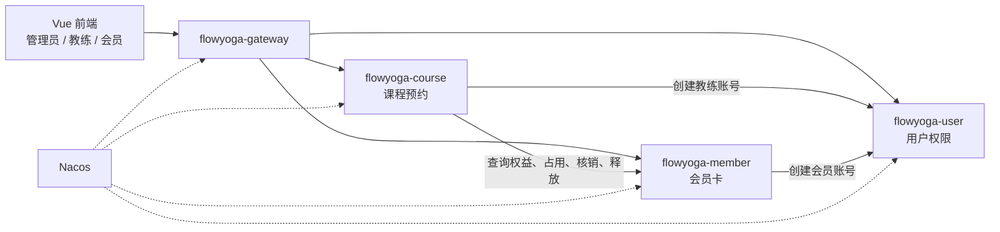

# FlowYoga 服务边界

第一期拆成 3 个业务服务，加上网关和 Nacos。每个业务服务只写自己的数据库。开发时可以共用一个 MySQL 实例，但分成三个逻辑库；服务需要别的数据时调用对方接口，不跨库查询。

## 1. 总览

排课、名额和预约放在课程服务里，名额扣减可以在一个本地事务中完成。会员卡单独成服务，预约时必须跨服务占用课次，用来实现并演示调用超时后的状态核对。

## 2. 服务职责

| 服务 | 职责 | 拥有的数据 |
| --- | --- | --- |
| flowyoga-user | 登录、账号、角色和权限 | 用户、角色、角色权限 |
| flowyoga-member | 会员档案、套餐、开卡、课次占用与核销 | 会员、次卡套餐、会员卡、课次流水 |
| flowyoga-course | 课程、教练资料、教室、排课、预约、签到 | 课程、教练、教室、课次、预约、签到结果 |
| flowyoga-gateway | 统一入口、路由、入口令牌校验 | 只保存路由和网关配置，不保存业务数据 |
| Nacos | 服务注册发现、统一配置 | 服务实例和配置 |

用户服务不保存会员档案和教练履历。课程服务不保存剩余次数。会员卡服务不保存课表和名额。

## 3. 允许的调用

| 调用方 | 被调用方 | 用途 | 幂等依据 |
| --- | --- | --- | --- |
| 前端 | 网关 | 全部页面请求 | 请求编号只用于日志 |
| 网关 | 三个业务服务 | 按路径转发已认证请求 | 不改写业务结果 |
| 课程服务 | 会员卡服务 | 查询可用次卡、占用、核销、释放 | 预约编号 |
| 课程服务 | 用户服务 | 创建教练账号 | 手机号或登录名 |
| 会员卡服务 | 用户服务 | 创建会员账号 | 手机号或登录名 |

会员卡服务不回调课程服务。用户服务不主动调用另外两个业务服务。前端不直接访问业务服务端口。

创建教练或会员时，由拥有档案的服务编排账号创建：课程服务创建教练，会员卡服务创建会员。账号创建成功但档案写入失败时，留下可重试的补偿记录，把刚创建的账号停用，避免出现无法登录解释的孤儿账号。

## 4. 第一期对外路径

网关按下面的前缀转发，不裁剪路径：

| 外部路径 | 目标服务 |
| --- | --- |
| `/api/user/**` | flowyoga-user |
| `/api/course/**` | flowyoga-course |
| `/api/member/**` | flowyoga-member |

会员卡服务另外提供 `/internal/**`，只给服务间调用。网关不转发这组路径。内部调用携带内部令牌；令牌用于区分服务调用和浏览器调用，正式部署时再换成服务间身份认证。

## 5. 一致性边界

一次预约涉及两个本地事务，中间没有分布式事务协调器。

1. 课程服务本地提交“名额加一，预约状态为处理中”。
2. 会员卡服务本地提交“剩余次数减一，流水变为已占用”。
3. 课程服务再把预约改为已预约。

第 2 步或第 3 步中断时，预约停留在处理中，会员看到的是处理中而不是成功。恢复动作使用同一个预约编号，具体规则见《业务规则》第 7 节。

名额条件更新和预约插入放在课程服务的同一个数据库事务里。同一会员和同一课次的有效预约用唯一约束挡住重复插入。课次流水以预约编号为主键，挡住重复扣次。

## 6. 逻辑数据

物理表结构和 ER 图放在 10 月 26 日至 11 月 15 日完成。当前先固定下面这些数据归属，避免后面把次数和名额写进同一个库。

### 用户权限服务

- 用户：登录名、密码摘要、姓名、手机号、状态、角色。
- 角色权限：管理员、教练、会员三类固定角色及其可访问的功能。第一期不做成可以在页面上随意组权限的通用平台。

### 会员卡服务

- 会员：用户编号、状态。
- 次卡套餐：名称、次数、有效天数、标价、状态。
- 会员卡：会员、套餐快照、总次数、剩余次数、开卡时间、到期时间、状态。
- 课次流水：预约编号、会员卡、状态（已占用、已核销、已释放）。预约编号唯一。

### 课程预约服务

- 教练：用户编号、状态。
- 课程：名称、难度、默认时长、状态。
- 教室：名称、容纳人数、状态。
- 课次：课程、教练、教室、起止时间、名额、已占用人数、状态。
- 预约：预约编号、课次、会员、使用的会员卡、状态。
- 同一课次和同一会员在有效状态下只能有一条预约。

## 7. 配置与运行边界

- 注册发现使用 Nacos。服务地址由注册中心提供，前端不填写服务实例地址。
- 配置使用 Nacos 的 `spring.config.import`。2025.1.0.0 不再使用 bootstrap 配置文件。业务配置在数据库设计阶段写入配置中心；本阶段先把注册发现跑通。
- 日志从网关生成或透传 `X-Request-Id`，下游写入同一条日志上下文。
- MySQL、Vue 页面、令牌签发和鉴权放到下一阶段。Sentinel 和 Redis 不进入当前运行依赖。

## 8. 本阶段的最小调用链

当前仓库已经按这个边界建立四个可启动模块。验收调用是：

`接口工具 → flowyoga-gateway → flowyoga-course → flowyoga-member`

课程服务通过 OpenFeign 和负载均衡访问会员卡服务的内部探针。探针返回固定示例，不读写会员卡数据库，用来证明服务注册和跨服务调用可用。真实的占用、核销和释放按第 5 节的协议在后续迭代实现。
