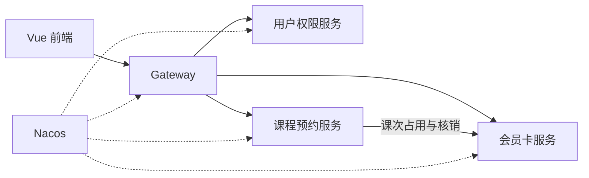

# 基于 Spring Cloud 的瑜伽馆管理系统设计与实现

## 开题提纲

项目名称：FlowYoga。本文是开题提纲，正式开题报告按学校模板从本提纲展开。论文章节最后服从学校模板。

## 一、选题依据

### 1. 背景

小型瑜伽馆的排课、预约和次卡消耗经常分散在表格、聊天记录和纸质签到里。名额是否已满、会员是否重复预约、取消后次数有没有退回，依赖人工核对。馆内同时存在管理员、教练和会员三类操作，权限混在一起时容易看到或修改不属于自己的数据。

把这些操作做成一个单门店系统，可以直接解决日常登记问题。选择 Spring Cloud 而不是单个 Spring Boot 应用，是为了把“课表名额”和“会员次数”分成两个可以独立失败的服务，从而在毕业设计里处理跨服务调用超时后的状态核对。这个拆分对应真实业务边界，不是为了增加服务数量。

### 2. 意义

- 实际意义：把排课、开卡、预约、签到、核销和统计收成一条可以演示的流程，减少超员、重复扣次和取消后退次不一致。
- 技术意义：在一套官方兼容的 Spring Boot、Spring Cloud 和 Spring Cloud Alibaba 版本上，完成服务注册、网关路由和跨服务调用，并处理并发预约与调用失败。
- 论文意义：三个实现问题都有可复现实验，分别是排课冲突、并发与重复预约、会员卡服务故障后的课次核对。

### 3. 国内外研究现状

正式开题前补完近五年文献，检索方向限定为：

- 健身场馆、瑜伽馆的会员、排课和预约管理。
- 管理系统中的角色权限和预约冲突检测。
- 微服务拆分、幂等、超时后的补偿和定时核对。

现状分析会区分两类工作：一类是单体场馆管理系统，功能完整但没有跨服务一致性问题；另一类是微服务示例，有注册中心和网关，但业务规则停留在接口转发。本文把团体课名额和次卡次数拆开，用预约编号把两边的处理结果对上。

技术资料以当前可运行版本为准，主要包括 Spring Boot 4.0、Spring Cloud 2025.1、Spring Cloud Alibaba 2025.1 和 Nacos 3.1 的官方说明，以及微服务设计中关于服务边界、幂等和故障隔离的通用方法。

## 二、研究目标与内容

### 1. 目标

设计并实现一个可部署的单门店瑜伽馆管理系统，支持管理员、教练和会员完成“排课 → 开卡 → 预约 → 到场登记 → 课后核销 → 统计”。系统在名额竞争、重复提交和会员卡服务调用失败时给出确定结果。

### 2. 研究内容

1. 确定单门店、团体课、次卡和三类角色的需求，写清取消、缺席、场馆取消和统计口径。
2. 按用户权限、课程预约、会员卡三个服务设计边界、数据库和接口。
3. 实现网关、注册配置、登录鉴权，以及会员、教练、课程、教室、排课和开卡。
4. 实现预约、取消、签到和课次占用、核销、释放，处理重复请求与调用中断。
5. 实现统计页面，完成并发测试、故障测试和可重复部署，并整理论文。

### 3. 拟解决的关键问题

1. 排课冲突检测。同一教练、同一教室在重叠时间不能安排两节课，错误提示说明冲突对象和时间。
2. 并发预约与重复提交。多人抢最后一个名额时不能超员；同一会员连续点击只产生一条有效预约。
3. 跨服务课次一致性。预约占用一次，签到只登记到场，未取消课程结束后核销到场或缺席记录。预约确认等待最多 120 秒且不跨越开课时间，关闭后立即释放名额，并持久保存课次返还任务。释放封存预约编号，防止迟到占用恢复已关闭的预约；使用幂等处理、退避重试和定时核对应对超时与重启。

### 4. 不纳入本文实现的内容

真实在线支付、多门店、私教套餐和小程序不实现。限流熔断留到系统测试前的服务治理阶段。没有明确缓存或会话需求时不引入 Redis。

## 三、研究方案与技术路线

### 1. 总体结构

前端使用 Vue 3。浏览器只访问 Spring Cloud Gateway。网关通过 Nacos 发现用户权限服务、课程预约服务和会员卡服务。课程服务在预约、签到和取消时调用会员卡服务。每个业务服务使用自己的 MySQL 逻辑库，通过 MyBatis 访问。

### 2. 技术选型

| 层次 | 选型 | 锁定版本 |
| --- | --- | --- |
| 语言与应用框架 | Java、Spring Boot | Java 21、Spring Boot 4.0.0 |
| 微服务 | Spring Cloud、Spring Cloud Alibaba | 2025.1.0、2025.1.0.0 |
| 注册与配置 | Nacos | 服务端 3.1.1，与客户端版本一致 |
| 入口与调用 | Spring Cloud Gateway、OpenFeign、LoadBalancer | 跟随 Spring Cloud 2025.1.0 |
| 安全与数据 | Spring Security、JWT、MySQL、MyBatis | 数据库设计阶段确定 MySQL 与 MyBatis 的补丁版本 |
| 前端 | Vue 3 与管理端组件库、图表组件 | 原型阶段确定补丁版本 |
| 运行 | Docker Compose、健康检查、带请求编号的日志 | 本阶段已编排 Nacos |

版本按官方兼容表整套选择。2026 年 10 月 12 日，Spring Cloud Alibaba 2025.1 线上发布版只有 2025.1.0.0，对应 Spring Cloud 2025.1.0 和 Spring Boot 4.0.0。后续补丁发布后，只在整套兼容关系成立时升级。

### 3. 关键实现路线

- 冲突检测：保存课次前查询同一教练、同一教室的未取消课次，按左闭右开区间判断重叠，错误信息带回冲突课次。
- 名额竞争：以“已占用人数小于名额”为条件更新课次，并给同一会员、同一课次的有效预约加唯一约束。
- 课次一致：会员卡流水以预约编号为主键。预约业务状态与课次同步状态分开保存，关闭预约、释放名额和保存释放任务在课程侧本地一起提交。会员卡侧支持占用前封存编号；只对未取消且已经结束的课程执行核销。定时任务按最新状态处理确认截止、迟到响应和补偿，不把未知结果直接改成成功。
- 权限：网关验证令牌，业务服务按角色和数据归属再次判断。教练签到时核对授课教练。

### 4. 可行性

- 技术：所选版本有官方兼容说明，本阶段用最小调用链验证网关、注册和 OpenFeign。
- 业务：规则限定在一家馆的团体课和次卡，主流程闭环完整，范围可以在计划时间内实现。
- 条件：开发使用已安装的 JDK 21、Maven 和 Docker。演示数据自行构造，不依赖真实支付或外部场馆系统。

## 四、论文章节安排

写作随开发进行，最后按学校模板排版。

| 章节 | 主要内容 | 积累时间 |
| --- | --- | --- |
| 绪论 | 背景、意义、现状、研究内容和论文结构 | 2026 年 10 月 |
| 相关技术 | Spring Cloud、Nacos、网关、OpenFeign、安全认证和数据访问 | 2026 年 10–11 月 |
| 需求分析 | 角色、功能、业务规则、主流程和非功能需求 | 2026 年 10 月 |
| 系统设计 | 服务边界、架构、数据库、接口、状态与异常处理 | 2026 年 11 月 |
| 系统实现 | 排课冲突、预约名额、到场登记、课后核销和跨服务核对 | 2026 年 12 月–2027 年 1 月 |
| 系统测试 | 权限、并发、故障恢复、统计核对和部署 | 2027 年 1 月 |
| 总结与展望 | 完成情况、不足，以及支付、多门店等后续工作 | 2027 年 2 月 |

## 五、进度安排

学校开题和中期检查日期确定后，只调整对应的检查材料，不压缩主流程的完成时间。

| 时间 | 工作重点 | 阶段成果 |
| --- | --- | --- |
| 2026/10/12–10/25 | 确定范围和规则，验证 Spring Cloud 基础 | 功能清单、业务规则、开题提纲；网关、注册和一次跨服务调用跑通 |
| 2026/10/26–11/15 | 架构、数据库、页面原型、权限基础 | 架构图、ER 图、接口约定；三个角色能登录并进入对应页面 |
| 2026/11/16–12/13 | 会员、会员卡、教练、课程、教室和排课 | 管理员能建档、开卡、建课和排课；冲突检测可用 |
| 2026/12/14–2027/1/10 | 预约、取消、签到、课次处理和联调 | 主流程完整；重复请求和异常调用有确定结果 |
| 2027/1/11–1/31 | 统计、服务治理、并发与故障测试、部署 | 功能基本定稿，测试报告和可重复部署版本 |
| 2027/2/1–2/14 | 论文初稿、图表、截图和实验数据 | 可交导师审阅的完整论文 |
| 2027/2/15–2/28 | 按反馈修改、修复缺陷、准备演示 | 论文修改版、答辩 PPT、演示视频、源码和部署说明 |
| 2027 年 3 月 | 按学校日期提交并答辩 | 最终提交材料 |

## 六、预期成果

1. 可运行的 FlowYoga 源码、部署说明和演示数据。
2. 覆盖权限、并发预约、故障核对、统计一致性和部署过程的测试记录。
3. 符合学校模板的毕业论文、答辩 PPT 和演示视频。

## 七、参考文献

文献综述的期刊论文在开题报告正文中按学校格式补充。下面先列出已经采用的技术文献和设计文献。

1. Spring Cloud Alibaba 社区. 版本发布说明（2025.x）[EB/OL]. https://sca.aliyun.com/docs/2025.x/overview/version-explain/ .
2. Spring Team. Spring Cloud 2025.1.0 (aka Oakwood) has been released[EB/OL]. https://spring.io/blog/2025/11/25/spring-cloud-2025-1-0-aka-oakwood-has-been-released , 2025-11-25.
3. Spring Team. Spring Boot 4.0 Migration Guide[EB/OL]. https://github.com/spring-projects/spring-boot/wiki/Spring-Boot-4.0-Migration-Guide .
4. Nacos 社区. Nacos 3.1 Docker 快速开始[EB/OL]. https://nacos.io/docs/v3.1/quickstart/quick-start-docker/ .
5. Newman S. Building Microservices[M]. 2nd ed. Sebastopol: O'Reilly Media, 2021.
6. Richardson C. Microservices Patterns[M]. Shelter Island: Manning Publications, 2018.
7. Jones M, Bradley J, Sakimura N. JSON Web Token (JWT), RFC 7519[S]. IETF, 2015.
