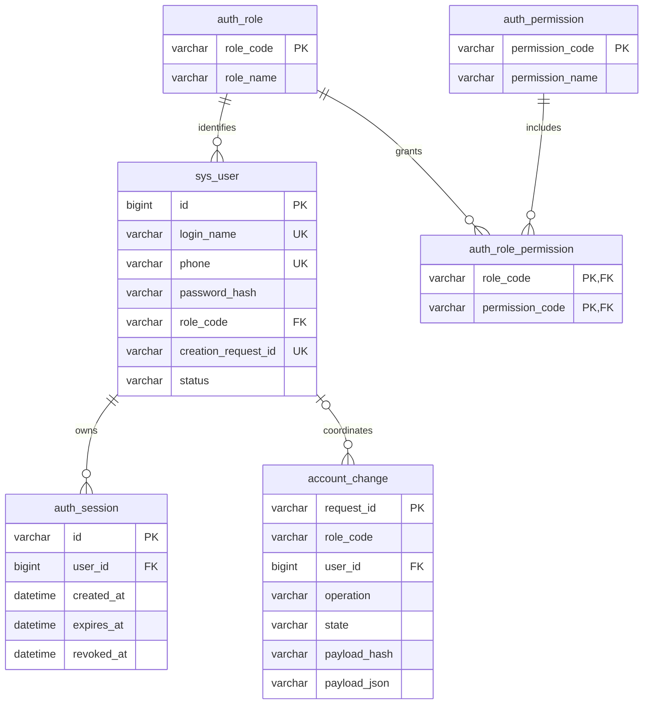
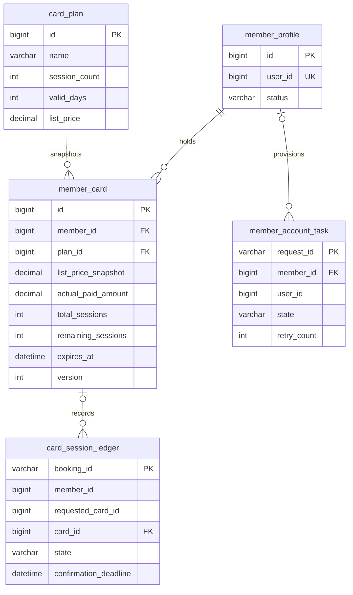
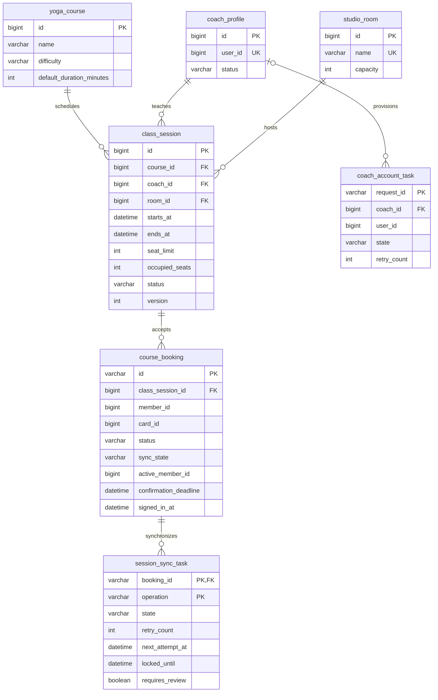

# FlowYoga 数据库设计

本版对应第二阶段：数据库、账号认证及管理员会员/教练管理已实现。开卡、排课、预约和课次补偿的表结构先确定，相关业务接口按后续计划实现。

## 1. 数据归属与约定

MySQL 8.0.16+，InnoDB，字符集 `utf8mb4`。默认采用 `utf8mb4_0900_ai_ci`，登录名和手机号在整个用户库中唯一。共 18 张业务表，三个库各有 Flyway 的迁移历史表。

| 逻辑库 | 所有者 | 业务表数量 | 建表来源 |
| --- | --- | --- | --- |
| `flowyoga_user` | 用户权限服务 | 6 | 用户服务 `db/migration` 的 V1 与 V2，由 Flyway 执行 |
| `flowyoga_member` | 会员卡服务 | 5 | 会员服务 `db/migration` 的 V1 与 V2；`database/02-member.sql` 保留初始结构 |
| `flowyoga_course` | 课程预约服务 | 7 | 课程服务 `db/migration` 的 V1 与 V2；`database/03-course.sql` 保留初始结构 |

每个服务使用独立数据库账号，仅授权自己的逻辑库。库内关联使用外键；用户编号、会员编号、会员卡编号等跨服务引用只保存编号，不建立跨库外键，不执行跨库 JOIN。库内业务数据通过停用或取消保留历史，不能为删除基础资料破坏预约或流水记录。

- 业务编号采用 `BIGINT`，API 将编号返回为字符串，避免前端整数精度损失。
- 预约编号、账号创建请求编号、登录会话编号采用 UUID 字符串 `VARCHAR(36)`。
- 金额采用 `DECIMAL(10,2)`，不使用浮点数。标价快照与实收金额分别保存。
- 所有 `DATETIME(6)` 存储 UTC；接口时间用带时区的 ISO 8601，页面按 `Asia/Shanghai` 展示。卡到期日先按上海时间计算，再换算到 UTC。
- `created_at` 和 `updated_at` 用于追踪记录；更新时业务服务必须更新 `updated_at`。有 `version` 的表用于条件更新或乐观锁。

## 2. 用户权限库 ER 图



| 表 | 字段及含义 | 约束与索引 |
| --- | --- | --- |
| `auth_role` | `role_code VARCHAR(16)`：ADMIN / COACH / MEMBER；`role_name VARCHAR(32)`：显示名称 | 角色编码主键，固定三种角色 |
| `auth_permission` | `permission_code VARCHAR(64)`：权限编码；`permission_name VARCHAR(64)`：显示名称 | 权限编码主键 |
| `auth_role_permission` | 角色编码与权限编码 | 两个编码组成联合主键，并分别关联角色与权限 |
| `sys_user` | `id BIGINT`；`login_name VARCHAR(50)`；`password_hash VARCHAR(255)`；`display_name VARCHAR(50)`；`phone VARCHAR(20)`；`role_code VARCHAR(16)`；`creation_request_id VARCHAR(36)`；`status VARCHAR(16)`；创建、更新时间 | 登录名、手机号分别唯一；账号创建请求编号可空且唯一；一个账号仅一个角色；状态限定 ACTIVE / DISABLED |
| `auth_session` | `id VARCHAR(36)`：JWT 的 jti；`user_id BIGINT`；`created_at`、`expires_at`、`revoked_at DATETIME(6)` | 会话编号主键；用户外键；用户与到期时间组合索引、到期时间索引；过期时间必须晚于创建时间 |
| `account_change` | 请求编号、会员/教练身份、操作 CREATE / UPDATE、状态 PREPARED / APPLIED / ABORTED、用户外键、资料指纹与 JSON、创建/更新时间 | 请求编号主键；按用户索引；新增可先保持停用，记录关闭编号；应用回执保证重复修改不覆盖后来的修改；快照不存密码 |

密码使用 BCrypt，不保存明文。JWT 本身不入库，只保存会话编号及撤销状态；登录有效期 30 分钟。用户服务在每次认证时检查会话是否有效、用户是否启用、令牌角色是否仍与账号一致。退出将该会话的 `revoked_at` 写入数据库，浏览器清除认证 Cookie。

`creation_request_id` 为创建教练/会员账号的幂等依据；补偿任务只能停用由该请求新建且尚未完成的账号，不能按手机号停用已有账号。用户服务另用 `account_change` 保存操作回执及关闭封存，协议见[管理员档案管理](08-管理员档案管理.md)。

## 3. 会员卡库 ER 图



| 表 | 核心字段 | 设计说明 |
| --- | --- | --- |
| `member_profile` | `id BIGINT`、`user_id BIGINT UNIQUE`、`status VARCHAR(16)`、`version INT`、创建/更新时间 | 用户编号为逻辑引用，姓名手机号由用户服务维护；档案状态和账号状态经持久任务同步；版本用于防止过期编辑 |
| `card_plan` | `name VARCHAR(80)`、`session_count INT`、`valid_days INT`、`list_price DECIMAL(10,2)`、`status` | 次数与有效天数必须大于 0，价格不得小于 0 |
| `member_card` | 会员与套餐外键；套餐名称、标价、有效天数快照；总次数与剩余次数；实收、金额差异原因、收款时间、开卡管理员；开卡与到期时间、状态、版本 | 剩余次数不得小于 0 或大于总次数；实收不得为负；实收与标价不同时必须记录非空原因；按会员、状态、到期时间建立索引 |
| `card_session_ledger` | `booking_id VARCHAR(36)`、请求会员与指定卡参数、实际卡外键、确认截止时间、状态、关闭原因、占用/核销/释放时间 | 每个预约编号一条流水；允许先释放封存，实际卡此时可空；HELD / CONSUMED 必须有实际卡；按卡与状态检索 |
| `member_account_task` | `request_id`、操作 CREATE / UPDATE / STATUS、已创建用户编号、会员外键、登录名、资料 JSON 与指纹、预期版本、任务状态、重试次数、下次执行时间、锁租约、最近错误 | 持久化账号创建与资料变更，不存密码；当前使用 PENDING / ACCOUNT_CREATED / DONE / COMPENSATED，保留 DISABLE_PENDING 供后续补偿扩展 |

流水中的 `member_id`、`requested_card_id` 为请求快照，不建立外键：不存在的会员或卡也可能需要封存失败预约编号。真正占用时必须在业务接口里确认卡属于该会员，并以实际 `card_id` 关联合法卡。流水唯一约束、状态条件更新和余额更新必须在同一个本地事务中完成。

封存的 RELEASED 记录不能被删除或再次变为 HELD。占用先到则释放返还一次；释放先到则写封存、不加次数，随后占用被拒绝。

## 4. 课程预约库 ER 图



| 表 | 核心字段 | 约束与索引 |
| --- | --- | --- |
| `coach_profile` | `user_id`、`specialty VARCHAR(255)`、`introduction VARCHAR(1000)`、状态、`version INT` | 用户编号唯一且为逻辑引用；版本检查防止覆盖其他管理员的修改 |
| `yoga_course` | 名称、难度、默认时长、简介、状态 | 难度限定 BEGINNER / INTERMEDIATE / ADVANCED；时长 1–240 分钟 |
| `studio_room` | `name VARCHAR(50)`、`capacity INT`、状态 | 教室名称唯一，容量大于 0 |
| `class_session` | 课程/教练/教室外键，起止时间，名额上限，占用人数，状态、版本、取消时间与原因 | 结束晚于开始且最多四小时；占用人数介于 0 和上限；按教练/教室及时间范围、状态及开始时间建立索引 |
| `course_booking` | UUID 主键、课次外键、会员及卡逻辑编号、业务状态与同步状态、确认截止/确认/到场/关闭时间、签到操作人、关闭原因、版本、有效会员生成列 | `(class_session_id, active_member_id)` 唯一；按会员与创建时间、处理状态与截止时间检索 |
| `session_sync_task` | 预约外键与操作联合主键，状态、重试次数、下次执行时间、锁租约到期时间、最近错误、待核对标记 | 操作 HOLD / RELEASE / CONSUME；同一预约的同一操作只有一条任务；状态 PENDING / RUNNING / DONE；按状态及下次执行时间检索 |
| `coach_account_task` | 请求编号、操作、已创建用户编号、教练外键、登录名、资料 JSON 与指纹、预期版本、状态、重试信息和锁租约 | 与会员账号任务对称，不存密码；支持新增、资料更新和启停恢复 |

### 4.1 有效预约唯一约束

不能简单对所有历史记录建立 `(课次, 会员)` 唯一约束，否则取消后不能重新预约。使用 MySQL 生成列：

```sql
active_member_id BIGINT GENERATED ALWAYS AS (
    CASE WHEN status IN ('CANCELLED', 'FAILED') THEN NULL ELSE member_id END
) STORED,
UNIQUE KEY uk_booking_active (class_session_id, active_member_id)
```

有效状态下，同一会员仅有一条预约；取消或失败后生成列为空，新预约使用新 UUID，旧记录仍保留。数据库的 NULL 唯一键语义允许保留多条关闭历史。

### 4.2 名额与排课

占名额和写预约在同一个本地事务中完成，例如：

```sql
UPDATE class_session
SET occupied_seats = occupied_seats + 1, version = version + 1
WHERE id = :id AND status = 'OPEN'
  AND starts_at > UTC_TIMESTAMP(6) AND occupied_seats < seat_limit;
```

必须检查更新行数为 1。重复预约唯一约束失败时整个事务回滚，不能留下额外占用。关闭预约、释放名额和写 RELEASE 任务也必须本地一起提交，只能从有效状态关闭一次。

时间重叠和教室容量属于跨行规则，不能靠普通 CHECK 或唯一约束完成。保存排课时按确定的顺序锁定涉及的教练与教室记录，再检查 `已有开始 < 新结束 AND 已有结束 > 新开始`；已取消课次排除。修改名额、教练、教室或时间时重新校验。课次取消、预约确认、签到和结算需共享课次锁或版本检查。

## 5. 状态与时间字段对应

| 业务文字 | 预约 status |
| --- | --- |
| 处理中 | PROCESSING |
| 已预约 | BOOKED |
| 已签到（仅到场） | CHECKED_IN |
| 已完成（到场且课后核销成功） | COMPLETED |
| 缺席（课后核销成功） | ABSENT |
| 已取消 | CANCELLED |
| 失败 | FAILED |

`sync_state` 独立限定为 PENDING_HOLD / HELD / PENDING_RELEASE / RELEASED / PENDING_CONSUME / CONSUMED。`confirmation_deadline` 初始化为创建后 120 秒与开课时间中的较早者，重试不能延长。签到只写 `signed_in_at` 和 CHECKED_IN；课程结束且未取消后才创建 CONSUME 任务。超时与取消关闭预约后立即释放课程名额，卡返还可稍后完成，页面分别展示进度。

`requires_review` 与任务 state 分开，超过十次失败只是标记待核对，不能丢弃任务或假报成功。任务租约 `locked_until` 允许服务重启后回收未完成的 RUNNING 任务。执行与回调都要检查最新预约状态，关闭编号不能再确认成功。

## 6. 本地部署与验证

```powershell
.\scripts\start-stage2.ps1
.\scripts\verify-database.ps1
.\scripts\stop-stage2.ps1
```

本机使用独立 13306 端口。Windows MySQL 对非 ASCII 文件路径存在限制，因此数据默认存放在 `%LOCALAPPDATA%/FlowYoga/<工作区路径哈希>/mysql`，每个工作区各有独立目录；也可以首次启动时用 `-MySqlDataRoot` 指定 ASCII 路径。[MySQL 官方 Windows 路径限制](https://dev.mysql.com/doc/refman/8.0/en/windows-restrictions.html)

数据目录位置和随机数据库密码、JWT 密钥记录在忽略的 `logs/stage2-local.properties`，不能提交；停止脚本正常关闭数据库并保留数据。已经初始化后不能直接改目录或丢弃本地配置，迁移时要一起保存数据和配置。

三个业务服务启动时执行各自 Flyway 迁移。已经用初始 SQL 建好的会员/课程库以版本 1 建立基线，再执行 V2 扩展；空库会先执行 V1。用户服务在 V1 账号表之后执行 V2 账号变更表。启动脚本还会补充独立随机的账号内部调用密钥。

`verify-database.ps1` 已在本机 MySQL 8.0.46 通过 16 项检查，覆盖实际建表、三个服务数据库账号隔离、密码摘要、登录名手机号唯一、有效预约重复拒绝、取消后再次预约成功、负金额拒绝、金额差异原因必填、无卡流水仅允许 RELEASED、名额上限。每项写入都在独立事务中回滚，不留下测试业务数据。用户认证另用 H2 的 MySQL 模式进行自动集成测试，实际 MySQL 验证负责覆盖生成列等方言特性。
